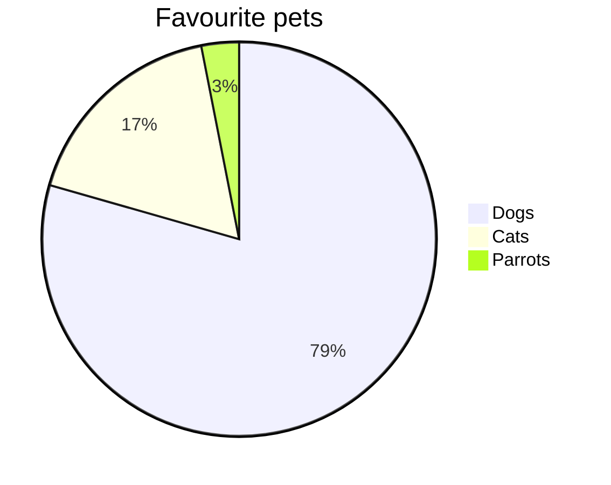

# Special rendering (neowriter specific)

## Dialogue — em-dash
Lines starting with `- ` (not a todo) are rendered with an em-dash:

`- She glanced at the window.`

- She glanced at the window.  
- He didn't answer.

## Scene break — dinkus
A line containing only `***` becomes a centred scene-break ornament:

`***`

***

## Arrows
Type these shorthands to get typographic arrows:

`-->` → &nbsp; `<--` ← &nbsp; `<-->` ↔

`==>` ⇒ &nbsp; `<==` ⇐ &nbsp; `<==>` ⇔

## Warning and arrow markers
Shortcodes for inline attention symbols:

`/!\` ⚠️ &nbsp; `/->\ ` ➡️ &nbsp; `/<-\ ` ⬅️

/!\ Take note of this

/->\ Continue reading below

/<-\ Go back to the previous section

## Dice
`[.]` through `[......]` render as dice-face symbols:

`[.]` `[..]` `[...]` `[....]` `[.....]` `[......]`

[.] [..] [...] [....] [.....] [......]

## Keyword tags (‡)
Lines starting with **‡** are keyword tags.
In a **tile**: tags appear in the story list next to the story name.
In a **highlight**: tags appear as pills in the left binder panel.

Type ‡ with a right-click → *Insert keyword*, or directly.

`‡example-tag`

‡example-tag

## Highlight hover
Typing a word that matches a highlight name in the editor shows a tooltip on hover in the preview, displaying the first lines of that highlight (and its picture, if any).

## Emoji shortcodes
`:shortcode:` is replaced with the corresponding emoji:

`:smile:` :smile: &nbsp; `:heart:` :heart: &nbsp; `:coffee:` :coffee: &nbsp; `:tada:` :tada:

## Diagrams (Mermaid)
Fenced code blocks tagged `mermaid` render as diagrams:

